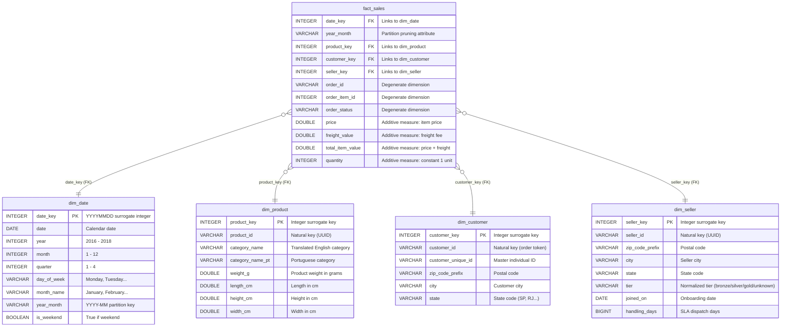

# Practical Assessment 1 (PA1): Analytical Storage Formats & Dimensional Modelling

**Institution**: Instituto Politécnico de Bragança (IPB) / UPB  
**Course Unit**: Data Engineering (2026/2027)  
**Deliverable**: Practical Assessment 1 (PA1) — NorthMart Marketplace Dimensional Analytical Layer  

---

## Executive Summary

NorthMart is an online e-commerce marketplace whose historical transactions (99,441 orders and 112,650 order items from September 2016 to October 2018) were previously queried directly from raw CSV exports and an uncurated JSON feed of seller profiles. Analysts faced poor query performance, divergent ad-hoc joins, lack of referential consistency, and schema ambiguities.

In this assessment, we engineer a Kimball-compliant star schema analytical layer in **DuckDB**, enforce data quality with surrogate keys and automated referential integrity checks, export curated datasets into compressed **Apache Parquet** layouts (both unpartitioned and partitioned by purchase month), and rigorously benchmark performance gains.

---

## 1. Task 1: Raw Data Profiling Findings

We executed comprehensive profiling across all 9 raw CSV tables (121.4 MB) and the JSON seller profiles (`data/source/northmart_seller_profiles.json`) using DuckDB (`sql/profiling.sql`). Below are five concrete empirical findings:

### Finding 1 (JSON — Temporal Duplication & Conflicting Updates)
The raw JSON export `northmart_seller_profiles.json` contains **3,095 total records** but only **3,070 unique `seller_id` values** (**25 duplicate records**).
- **Evidence**: Sellers such as `dc120d932ddf9d4dfb6fd68beefda622` appear twice with different `updated_at` timestamps (`2017-06-15 09:00:00` and `2018-02-19 18:00:00`).
- **Engineering Action**: We implement deduplication via window function:  
  `QUALIFY ROW_NUMBER() OVER (PARTITION BY seller_id ORDER BY updated_at DESC) = 1` to isolate the most recent valid profile state per seller.

### Finding 2 (JSON — Casing Inconsistencies & Structural Nulls)
The seller profiles exhibit uncleaned operational export defects:
- **String Casing & Whitespace**: The `profile.tier` field contains 9 distinct raw casing variants and trailing whitespace (`'Silver '`, `'SILVER'`, `'silver'`, `'Gold '`, `'GOLD'`, `'gold'`, `'Bronze '`, `'BRONZE'`, `'bronze'`).
- **Missing Shipping Objects**: 30 records (0.97%) have completely `NULL` `shipping` objects, resulting in `NULL` for both `shipping.handling_days` and `shipping.carriers`.
- **Engineering Action**: We apply string normalization (`LOWER(TRIM(profile.tier))`) and impute missing `handling_days` with a sentinel default (`-1`) to avoid silent row omissions.

### Finding 3 (Cross-Source Seller Discrepancies)
Comparing the master CSV seller directory (`olist_sellers_dataset.csv`, 3,095 sellers) against the JSON seller export (3,070 unique sellers):
- **40 sellers present in the CSV are absent from the JSON export**.
- **15 sellers present in the JSON export are absent from the CSV orders/sellers**.
- **Engineering Action**: We execute a `LEFT JOIN` anchored on the CSV sellers master table, ensuring that 100% of marketplace sellers remain available with conformed defaults (`'unknown'` tier, default handling days) so zero fact records lose referential integrity.

### Finding 4 (Orders & Items — Granularity & Lifecycle Nulls)
The orders dataset contains **99,441 unique orders**, while the order items dataset contains **112,650 items** (a 1:N cardinality averaging 1.13 items per order, up to 21 items in a single transaction).
- Orders exhibit structural status-dependent nulls: **2,965 orders (2.98%)** have `NULL` `order_delivered_customer_date` (orders in-transit, created, or canceled) and **160 orders** have `NULL` `order_approved_at`.
- **Engineering Action**: Transaction revenue is tied strictly to the order purchase timestamp rather than delivery dates.

### Finding 5 (Product Catalog Nulls & Missing Translations)
Among **32,951 catalog products**:
- **610 products (1.85%)** have `NULL` `product_category_name`.
- Translating Portuguese category names via `product_category_name_translation.csv` reveals that 2 categories (`pc_gamer` and `portateis_cozinha_e_preparadores_de_alimentos`) lack English entries.
- **Engineering Action**: Following Kimball best practices, nulls in descriptive dimensions are coalesced to `'unknown'`, preventing `INNER JOIN` record loss.

---

## 2. Task 2: Star Schema Architecture



### Declared Grain
> **"One row per line item within an order placed on the NorthMart marketplace."**

### Measures (Fully Additive)
1. `price`: Item base sale price (currency units). Fully additive across all dimensions.
2. `freight_value`: Shipping cost allocated to the item line. Fully additive.
3. `total_item_value`: Net financial transaction value (`price + freight_value`). Fully additive.
4. `quantity`: Numeric integer `1` per row, allowing instantaneous calculation of item volumes (`SUM(quantity)`).

### Non-Obvious Modelling Decision
**Anchoring the primary date dimension to `order_purchase_timestamp` and preserving `order_id` as a degenerate dimension:**
In the Olist data model, each order item contains multiple temporal candidates: `order_purchase_timestamp`, `order_approved_at`, `shipping_limit_date`, `order_delivered_carrier_date`, and `order_delivered_customer_date`. A naive approach might model separate date foreign keys or anchor sales to the delivery date. However, **2,965 orders have no delivery date**, and revenue is recognized commercially at the moment of customer checkout. We explicitly anchored the primary `date_key` to the purchase date. Furthermore, rather than building a bloated `dim_order` table (which would introduce an extra join solely for order metadata), `order_id`, `order_item_id`, and `order_status` are kept directly within the fact table as **degenerate dimensions** (Kimball design pattern), eliminating join overhead while preserving transaction traceability.

---

## 3. Task 3: SQL Implementation & Referential Checks

The model is implemented in `sql/build_model.sql` and executed natively in DuckDB:
- **Surrogate Keys**: Integer keys generated deterministically via `ROW_NUMBER() OVER (ORDER BY natural_key)`.
- **JSON Processing**: DuckDB's `read_json_auto()` extracts nested structs (`profile.tier`, `profile.joined_on`, `shipping.handling_days`). Deduplication is performed using `QUALIFY ROW_NUMBER() OVER (PARTITION BY seller_id ORDER BY updated_at DESC) = 1`.
- **Referential Integrity Validation**: 4 automated SQL assertions verify foreign key relationships:
  - `fact_sales -> dim_date`: **0 orphaned records (PASSED)**
  - `fact_sales -> dim_product`: **0 orphaned records (PASSED)**
  - `fact_sales -> dim_customer`: **0 orphaned records (PASSED)**
  - `fact_sales -> dim_seller`: **0 orphaned records (PASSED)**
  - Total Fact Records Loaded: **112,650 items** (100% data preservation).

---

## 4. Task 4: Parquet Storage & Benchmark Results

The fact table was exported to Parquet under two physical storage layouts:
1. **Unpartitioned**: `data/curated/fact_sales.parquet` (single file, compressed with Zstandard).
2. **Partitioned**: `data/curated/fact_sales_partitioned/` (partitioned by `year_month`, yielding 24 directory partitions).

### 4.1 Storage Footprint Comparison

| Storage Layout | Format & Details | Disk Size (MB) | Raw Byte Count | Space Reduction vs Full Raw |
| :--- | :--- | :---: | :---: | :---: |
| **Full Raw Source** | 9 CSV files + 1 JSON file | **121.40 MB** | 127,293,345 | Baseline (100%) |
| **Core Query CSVs** | Items + Orders + Products + Translation | **33.83 MB** | 35,475,644 | Baseline Core |
| **Parquet Unpartitioned** | Single file (`fact_sales.parquet`, ZSTD) | **3.49 MB** | 3,658,370 | **-97.1%** |
| **Parquet Partitioned** | Partitioned by `year_month` (24 folders) | **3.63 MB** | 3,809,565 | **-97.0%** |

*Takeaway: Columnar encoding combined with ZSTD compression reduces storage footprint by over 97% compared to raw source files.*

### 4.2 Query Execution Latency Comparison (Average of 5 Runs in DuckDB)

| Query | Raw CSV Layout | Parquet Unpartitioned | Parquet Partitioned | Speedup (vs CSV) |
| :--- | :---: | :---: | :---: | :---: |
| **Query 1: Monthly Revenue (Whole Period)** | 178.47 ms | 8.85 ms | **7.51 ms** | **23.8x faster** |
| **Query 2: Single Month Revenue & Items (2018-05)** | 160.23 ms | 6.32 ms | **3.18 ms** | **50.4x faster** |
| **Query 3: Top 5 Product Categories by Revenue** | 134.85 ms | 13.96 ms | **11.42 ms** | **11.8x faster** |

*Raw measurements: [`evidence/benchmark_table.csv`](evidence/benchmark_table.csv) · Full analysis: [`evidence/benchmark_results.md`](evidence/benchmark_results.md)*

### Benchmark Query Results
- **Query 2 Output (`2018-05`)**: Revenue = `$996,517.68`, Item Count = `7,925 items`.
- **Query 3 Output (Top 5 Categories)**:
  1. `health_beauty`: $1,258,681.34 (9,670 items)
  2. `watches_gifts`: $1,205,005.68 (5,991 items)
  3. `bed_bath_table`: $1,036,988.68 (11,115 items)
  4. `sports_leisure`: $988,048.97 (8,641 items)
  5. `computers_accessories`: $911,954.32 (7,827 items)

### Benchmarking Methodology
- **Execution Platform**: DuckDB v1.1.3 running on Linux x86_64.
- **Isolation**: Each layout was queried 6 consecutive times; the initial run was discarded as a warm-up, and the subsequent 5 iterations were recorded using high-precision hardware clocks (`time.perf_counter()`).
- **Run-to-run variability**: Absolute timings vary by a few ms between runs (OS cache, background load); the demo video shows a separate run with the same relative results (CSV ≈ 160–180 ms vs partitioned Parquet ≈ 3–8 ms). Storage sizes are deterministic.
- **Performance Rationale**:
  - **Column Projection**: Queries touch only 2–3 columns (`price`, `quantity`, `date_key`). Parquet ignores unreferenced columns entirely, whereas CSV must read every byte line-by-line.
  - **Partition Pruning**: In Query 2, partitioned Parquet skips 23 out of 24 directories based on metadata, reading only the `year_month=2018-05` directory and finishing in **3.18 ms**.

---

## 5. Task 5: Written Architecture Question

**Question**: *Would NorthMart be better served by a data warehouse, a data lake or a lakehouse? Justify with two facts from your own measurements (max. 150 words).*

> NorthMart is best served by a **lakehouse architecture** combining open columnar storage (Parquet) with an embedded analytical engine (DuckDB).
> 
> First, our measurements demonstrate that Parquet compression slashes storage from 121.4 MB across raw files to 3.49 MB—a **97.1% storage reduction**. Storing data in open object storage avoids the excessive licensing and proprietary storage expenses of a traditional cloud data warehouse for NorthMart’s moderate 112k-row volume.
> 
> Second, query execution latencies dropped from 160.23 ms in raw CSV to **3.18 ms in partitioned Parquet** (a **50.4x speedup** via partition pruning). A pure data lake lacks ACID transactions, schema enforcement, and table management (risking a "data swamp"). A lakehouse delivers open-format storage efficiency, ACID reliability, and near-instant local SQL querying without vendor lock-in.

*(Word count: 128 words — strictly compliant with the 150-word ceiling).*

---

## 6. How to Reproduce

### Prerequisites
- Python 3.10+
- DuckDB CLI v1.1.0+ (or Python `duckdb` package)
- Install requirements:
  ```bash
  pip install -r requirements.txt
  ```
- **Raw data (not included in this submission, per the brief)**: download the 9 CSV files of the [Brazilian E-Commerce Public Dataset by Olist](https://www.kaggle.com/datasets/olistbr/brazilian-ecommerce) and the course file `northmart_seller_profiles.json`, and place them, with their original file names, in `AP1/data/source/`.
- The curated Parquet outputs are already included in `data/curated/`, so the benchmark queries can be inspected without rebuilding.

### Step-by-Step Execution
From the `AP1/` folder:

1. **Run Raw Profiling**:
   ```bash
   duckdb < sql/profiling.sql
   ```
2. **Build Model, Verify Integrity & Export Parquet**:
   ```bash
   duckdb northmart.duckdb < sql/build_model.sql
   ```
3. **Execute Benchmark Suite**:
   ```bash
   python3 src/run_benchmark.py
   ```
4. **Run Automated Integrity Tests**:
   ```bash
   python3 tests/run_tests.py
   ```

---

## 7. Deliverable File Manifest (Student Brief §2.1.3)

| Repository Path | Description |
| :--- | :--- |
| `README.md` | Academic submission report answering Tasks 1–5 |
| `sql/profiling.sql` | DuckDB raw data profiling script (Task 1) |
| `architecture/star_schema.png` | Visual schema diagram (Dark theme, Task 2) |
| `architecture/star_schema.mmd` | Mermaid source definition of schema (Task 2) |
| `sql/build_model.sql` | End-to-end star schema ETL & Parquet export script (Task 3) |
| `sql/benchmark.sql` | The 3 benchmark queries across all 3 layouts (Task 4) |
| `src/run_benchmark.py` | Benchmark timing & measurement harness (Task 4) |
| `src/generate_diagram.py` | Generates star schema PNG diagram |
| `data/curated/fact_sales.parquet` | Unpartitioned curated Parquet output (Task 4) |
| `data/curated/fact_sales_partitioned/`| Partitioned Parquet directory layout (Task 4) |
| `evidence/benchmark_results.md` | Benchmark table and analysis (Task 4) |
| `evidence/benchmark_table.csv` | Raw timing measurements table (Task 4) |
| `tests/test_referential_integrity.sql`| SQL referential integrity test assertions |
| `tests/run_tests.py` | Automated test runner script |
| `evidence/profiling_output.txt` | Captured stdout from DuckDB profiling |
| `evidence/referential_checks_output.txt`| Captured stdout from referential tests |
