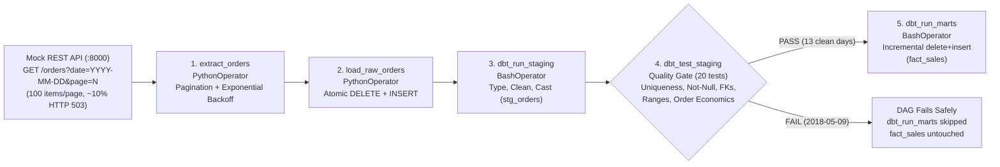

# Practical Assessment 2 (AP2): Orchestrated and Tested ELT Pipeline

**Institution**: Universidade Politécnica de Bragança (UPB)  
**Course Unit**: Data Engineering (2026/2027)  
**Deliverable**: Practical Assessment 2 (AP2) — NorthMart Orchestrated & Tested ELT Pipeline  
**Group**: Lucas Alves Rubira (a67707) · Dorota Dudkowiak (m324637) · Aye Khine Lwin (a70733)

---

## Executive Summary

In AP1, NorthMart's star schema (`dim_date`, `dim_product`, `dim_customer`, `dim_seller`, and `fact_sales`) was built manually from static CSV and JSON files. In **AP2**, we replace that manual load with an automated, daily **ELT pipeline** (Extract, Load, Transform — a workflow that saves raw data first and transforms it inside the database).

Each day from `2018-05-01` to `2018-05-14` is:
1. **Extracted** from a paginated **REST API** (a web endpoint returning JSON pages over HTTP) with automatic retries on temporary HTTP `503` errors.
2. **Loaded unchanged** into a **Raw Layer** (both JSON files in `data/raw/` and table `raw_api_orders` in DuckDB).
3. **Staged and typed** in **dbt** (Data Build Tool — a SQL framework for building and testing data models) into `stg_orders`.
4. **Checked by a Quality Gate** (20 automated `dbt test` rules) before touching the final analytics table.
5. **Merged incrementally** into `fact_sales` using an **idempotent** strategy (running the same date twice produces the exact same rows, with zero duplicates).

---

## Pipeline Architecture




---

## 1. Task 1: Extraction & Raw Loading

Implemented in [`src/extract_orders.py`](src/extract_orders.py) and [`src/load_raw.py`](src/load_raw.py):

- **Pagination** (*splitting large results into fixed-size pages*): `extract_orders.py` starts at `page=1`, reads `total_pages` from the JSON response, and loops until every page for `batch_date` is fetched (3 to 5 pages per day, 100 items per page).
- **Fault Tolerance with Exponential Backoff** (*waiting progressively longer between retries*): When the API returns HTTP `503` (`temporarily unavailable`) or a network error, `_fetch_page_with_retries()` retries up to 6 times with delays of `0.5s, 1.0s, 2.0s, 4.0s...`.
- **Raw Preservation**: Each HTTP response body is written byte-for-byte unchanged to `data/raw/<YYYY-MM-DD>/page_<N>.json`.
- **Atomic & Idempotent Raw Load**: `load_raw.py` wraps `DELETE FROM raw_api_orders WHERE batch_date = ?` and `INSERT INTO raw_api_orders` inside a single **database transaction** (*an all-or-nothing operation*). Across the 14 days, **4,471 raw rows** were landed cleanly.

---

## 2. Task 2: Transformation in dbt

Implemented in [`dbt/`](dbt/):

- **Source Declarations** ([`dbt/models/staging/sources.yml`](dbt/models/staging/sources.yml)): Registers `raw_api_orders` and the four **conformed dimensions** (*shared lookup tables built in AP1*: `dim_date`, `dim_product`, `dim_customer`, `dim_seller`).
- **Staging Model** ([`dbt/models/staging/stg_orders.sql`](dbt/models/staging/stg_orders.sql)):
  - Scoped to the active `batch_date` passed via `--vars '{"batch_date": "YYYY-MM-DD"}'`.
  - Trims identifiers, normalizes `order_status` to lowercase, parses `order_purchase_timestamp`, derives `date_key` (`YYYYMMDD`), `year_month` (`YYYY-MM`), `order_item_key` (`order_id || '-' || order_item_id`), and `total_item_value` (`price + freight_value`).
  - **No silent filtering**: Corrupt rows are preserved in `stg_orders` so that `dbt test` catches every defect instead of hiding data loss.
- **Incremental Mart Model** ([`dbt/models/marts/fact_sales.sql`](dbt/models/marts/fact_sales.sql)):
  - Configured with `materialized='incremental'`, `unique_key=['order_id', 'order_item_id']`, and `incremental_strategy='delete+insert'`.
  - Joins `stg_orders` with the AP1 dimensions to attach integer **surrogate keys** (*model-generated integer keys*: `product_key`, `customer_key`, `seller_key`) and writes only verified rows to `fact_sales`.

---

## 3. Task 3: Data Quality Gate (20 dbt Tests)

Defined in [`dbt/models/staging/schema.yml`](dbt/models/staging/schema.yml), [`dbt/macros/test_accepted_range.sql`](dbt/macros/test_accepted_range.sql), and [`dbt/tests/assert_valid_marketplace_order_economics.sql`](dbt/tests/assert_valid_marketplace_order_economics.sql):

| Category | dbt Test(s) | Target Column / Scope | Purpose |
| :--- | :--- | :--- | :--- |
| **Uniqueness** | `unique` | `order_item_key` | Enforces order-item **grain** (*one row per item in an order*) |
| **Not-Null** | `not_null` (10 tests) | Keys, status, timestamp, `price`, `freight_value` | Prevents missing identifiers or measures |
| **Referential Integrity** | `relationships` (4 tests) | `customer_id`, `product_id`, `seller_id`, `date_key` | Verifies every row maps to AP1 dimensions |
| **Accepted Range** | `accepted_range` (custom macro, 2 tests) | `price` (`0.01..50000`), `freight_value` (`0.00..10000`) | Rejects negative/zero prices and invalid freight |
| **Accepted Values** | `accepted_values` (1 test) | `order_status` | Allows only valid marketplace order states |
| **Custom Business Rule** | `assert_valid_marketplace_order_economics` | Order-level (`GROUP BY order_id, batch_date`) | Requires positive net merchandise revenue (`SUM(price) > 0`), settlement > freight, and purchase date = `batch_date` |

- Clean day output (`2018-05-01`): [`evidence/dbt_test_clean_day.txt`](evidence/dbt_test_clean_day.txt) (**20/20 PASS**).
- Corrupted day output (`2018-05-09`): [`evidence/dbt_test_corrupted_day.txt`](evidence/dbt_test_corrupted_day.txt) (**16 PASS, 4 FAIL**).

---

## 4. Task 4: Airflow Orchestration, 14-Day Backfill & Idempotency

Implemented in [`airflow/dags/northmart_elt_dag.py`](airflow/dags/northmart_elt_dag.py):

- **DAG ID**: `northmart_ap2_elt_pipeline` (`@daily`, `start_date=2018-05-01`, `end_date=2018-05-14`, `catchup=True`).
- **Concurrency Control**: `max_active_runs=1` and `max_active_tasks=1` ensure sequential writes because DuckDB allows only **one writer at a time** (*single-writer file locking*).
- **Backfill Result**:
  - **13 clean days** (`2018-05-01`..`2018-05-08`, `2018-05-10`..`2018-05-14`) succeeded end-to-end, loading **4,059 clean order items** into `fact_sales`.
  - **1 corrupted day** (`2018-05-09`) failed at `dbt_test_staging` and stopped before `dbt_run_marts`.


### Idempotent Re-Run Verification (`2018-05-01`)
Clearing and re-running `scheduled__2018-05-01T00:00:00+00:00` in Airflow produced identical counts before and after ([`evidence/idempotency_check.txt`](evidence/idempotency_check.txt)):
- `raw_api_orders`: **4,471 total** (**277** for `2018-05-01`) before and after.
- `fact_sales`: **4,059 total** (**277** for `20180501`) before and after; total revenue = **$516,868.71** before and after.

### Independent Verification Suite
Running `python tests/run_tests.py` ([`evidence/referential_checks_output.txt`](evidence/referential_checks_output.txt)) confirms **7/7 checks PASS** (all 4 foreign keys, positive measures, unique grain, and `0` rows from `2018-05-09` in `fact_sales`).

---

## 5. Task 5: Incident Analysis & Handling

- **Corrupted Day Identified**: **`2018-05-09`** (412 raw rows extracted and staged).
- **Defects Caught by `dbt test`**:
  1. `unique_stg_orders_order_item_key`: **20** duplicate `(order_id, order_item_id)` rows.
  2. `not_null_stg_orders_customer_id`: **10** rows with `NULL` `customer_id`.
  3. `accepted_range_stg_orders_price__50000_0__0_01`: **15** rows with negative prices (from `-21.00` to `-299.00`).
  4. `assert_valid_marketplace_order_economics`: **12** orders failing positive merchandise revenue / net settlement checks.
- **Proof Marts Were Protected**: Airflow marked `dbt_test_staging` as `failed` and skipped `dbt_run_marts` (`upstream_failed`). Querying `fact_sales WHERE date_key = 20180509` returns **0 rows**, while the other 13 clean days remain intact (`4,059` rows).

**How the corrupted batch should be handled (5 lines):**
1. Keep the corrupted batch quarantined in `raw_api_orders` (and optionally copy failing rows via `dbt --store-failures` into an incident table) without touching `fact_sales`.
2. Send an automated alert containing the 4 failed test names and failing `order_id` keys to the upstream order-service team.
3. Ask the source team to fix the upstream export bugs (duplicate items, missing `customer_id`, negative prices) and republish the corrected `2018-05-09` feed.
4. Once fixed, clear only the `2018-05-09` DAG run in Airflow so `extract_orders` through `dbt_run_marts` re-run automatically.
5. Because `load_raw_orders` and `fact_sales` (`delete+insert`) are idempotent, re-running `2018-05-09` repairs the missing day cleanly with zero duplicate rows.

---

## 6. Task 6: Written Question — Slowest Task & Optimisation

**Measured Task Durations Across the 14-Day Backfill** ([`evidence/task_durations.csv`](evidence/task_durations.csv) · [`evidence/task_durations.md`](evidence/task_durations.md)):

| Task ID | Average Duration (s) | Min (s) | Max (s) | Total Across 14 Runs (s) |
| :--- | :---: | :---: | :---: | :---: |
| `dbt_run_staging` | **5.775** | 5.281 | 6.494 | 80.856 |
| `dbt_test_staging` | **4.675** | 4.084 | 5.251 | 65.451 |
| `dbt_run_marts` | **4.341** | 3.758 | 4.893 | 56.430 |
| `load_raw_orders` | **0.611** | 0.442 | 1.003 | 8.550 |
| `extract_orders` | **0.580** | 0.186 | 3.488 | 8.113 |

**Answer (max. 100 words):**

> From the Airflow task durations, the slowest task is **`dbt_run_staging`** (averaging **5.78 seconds** per run, **80.86 seconds** total across 14 runs), followed closely by `dbt_test_staging` (4.68 s) and `dbt_run_marts` (4.34 s). Although transforming ~300 DuckDB rows takes under 0.2 s, each `BashOperator` task spawns a fresh `dbt` CLI subprocess that repeatedly boots Python, parses YAML/SQL metadata, and opens DuckDB.
>
> **Optimisation:** Invoke dbt through its in-process `dbtRunner` Python API inside a single worker (or consolidate into `dbt build` for staging+tests), eliminating repeated subprocess startup and YAML parsing overhead per run.

*(Word count: 94 words — strictly within the 100-word limit).*

---

## 7. How to Reproduce (Step-by-Step)

### Prerequisites
- Linux, macOS, or **WSL2** (Airflow does not run natively on Windows).
- Python **3.12** and raw data files placed in `AP2/data/source/` (`northmart_api_feed.parquet` + the AP1 Olist CSVs & `northmart_seller_profiles.json`).

### 1. Create the Virtual Environment and Install Dependencies
From the repository root:
```bash
python3.12 -m venv .venv
source .venv/bin/activate
pip install -r AP2/requirements.txt
```

### 2. Initialize the Fresh AP2 DuckDB Database
From `AP2/`:
```bash
cd AP2
python src/init_db.py --rebuild
```
This builds the AP1 conformed dimensions (`dim_date`, `dim_product`, `dim_customer`, `dim_seller`), empties `fact_sales` (`0` rows), and creates `raw_api_orders`.

### 3. Start the Mock REST API (Terminal 1)
From `AP2/`:
```bash
uvicorn mock_api:app --port 8000
```

### 4. Run the Airflow Standalone & 14-Day Backfill (Terminal 2)
From `AP2/`:
```bash
export AIRFLOW_HOME="$(pwd)/airflow"
export AIRFLOW__CORE__DAGS_FOLDER="$(pwd)/airflow/dags"
export AIRFLOW__CORE__LOAD_EXAMPLES=False

airflow db migrate
airflow standalone
```
In a third terminal (with the same `AIRFLOW_HOME` and `.venv` active), unpause the DAG to trigger the 14-day `catchup=True` backfill (`2018-05-01` to `2018-05-14`):
```bash
airflow dags unpause northmart_ap2_elt_pipeline
```
Watch the Grid View at `http://localhost:8080` (credentials printed by `airflow standalone`).

### 5. Verify Idempotency & Independent Checks
```bash
# Re-run 2018-05-01 via Airflow to verify identical counts
airflow dags clear --run-id scheduled__2018-05-01T00:00:00+00:00 -y northmart_ap2_elt_pipeline

# Run independent DuckDB integrity & gate checks
python tests/run_tests.py
```

---

## 8. Deliverable File Manifest

| Path | Description |
| :--- | :--- |
| `README.md` | AP2 documentation, architecture overview, and answers to Tasks 1–6 |
| `requirements.txt` | Pinned dependencies (Airflow 3.3.2, DuckDB 2.0.0, dbt-core 1.12.6, dbt-duckdb 1.11.1, FastAPI) |
| `mock_api.py` | Local FastAPI mock service reading `data/source/northmart_api_feed.parquet` |
| `architecture/pipeline_ap2.png` & `.mmd` | Visual pipeline architecture diagram |
| `sql/init_ap2_db.sql` | Resets `fact_sales` and creates `raw_api_orders` |
| `src/init_db.py` | Initializes the fresh AP2 DuckDB file from AP1 dimensions |
| `src/extract_orders.py` | Paginated REST API extractor with exponential backoff retries |
| `src/load_raw.py` | Atomic, idempotent raw JSON loader into DuckDB |
| `dbt/` | Complete dbt project (`stg_orders`, `fact_sales`, `accepted_range` macro, 20 tests) |
| `airflow/dags/northmart_elt_dag.py` | 5-task Airflow DAG with daily schedule, catchup backfill, and single-writer control |
| `tests/test_referential_integrity.sql` & `run_tests.py` | Independent verification checks outside dbt |
| `evidence/` | Airflow grid view PNG, dbt test logs, idempotency check, and measured task durations |
