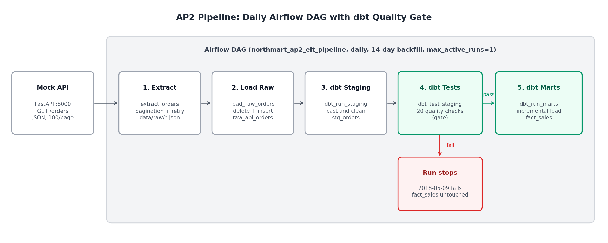
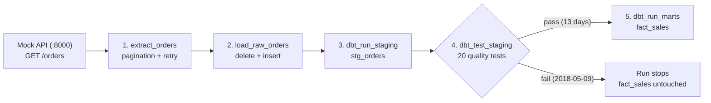
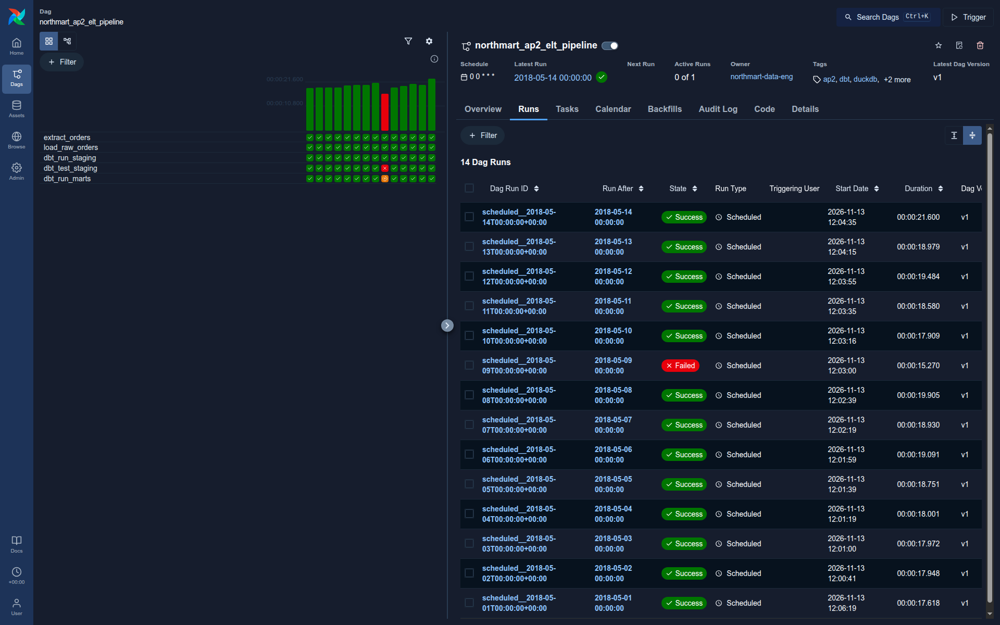

# Practical Assessment 2 (AP2): Orchestrated and Tested ELT Pipeline

**Institution**: Universidade Politecnica de Braganca (UPB)  
**Course Unit**: Data Engineering (2026/2027)  
**Deliverable**: Practical Assessment 2 (AP2)  
**Group**: Lucas Alves Rubira (a67707), Dorota Dudkowiak (m324637), Aye Khine Lwin (a70733)

## Overview

In AP1, we built the NorthMart star schema (`dim_date`, `dim_product`, `dim_customer`, `dim_seller`, and `fact_sales`) manually from static CSV and JSON files. In AP2, we replace the manual load of `fact_sales` with an automated daily ELT pipeline (Extract, Load, Transform: saving raw data first and transforming it inside the database).

For each day from `2018-05-01` to `2018-05-14`, the pipeline runs five steps in sequence:
1. Extract daily orders from a paginated REST API (an HTTP web endpoint that returns JSON data in pages) with automatic retries when HTTP `503` errors occur.
2. Save the raw JSON pages to `data/raw/` and load them unchanged into the `raw_api_orders` table in DuckDB.
3. Clean and cast the raw records into the `stg_orders` staging table using dbt (Data Build Tool, a SQL tool for building and testing models).
4. Run 20 automated dbt quality tests on `stg_orders` as a quality gate (a checkpoint that stops the pipeline if any test fails).
5. Load the verified records incrementally into `fact_sales` using an idempotent strategy (running the same date twice gives the exact same result without duplicates).

## Pipeline Diagram





## 1. Task 1: Extraction and Raw Loading

Implemented in [`src/extract_orders.py`](src/extract_orders.py) and [`src/load_raw.py`](src/load_raw.py):

- **Pagination** (fetching a large result set one page at a time): `extract_orders.py` requests `page=1`, reads `total_pages` from the response, and loops until all pages for that `batch_date` are downloaded (100 items per page, 3 to 5 pages per day).
- **Retry with exponential backoff** (waiting longer after each failed attempt): The mock API randomly returns HTTP `503` (`temporarily unavailable`) on about 10% of requests. `_fetch_page_with_retries()` retries up to 6 times with delays of `0.5s, 1.0s, 2.0s, 4.0s...`.
- **Raw layer preservation**: Every JSON page is saved unchanged to `data/raw/<YYYY-MM-DD>/page_<N>.json`.
- **Idempotent raw table load**: `load_raw.py` runs `DELETE FROM raw_api_orders WHERE batch_date = ?` followed by `INSERT INTO raw_api_orders` inside one database transaction (an all-or-nothing database block). Across the 14 days, `4,471` raw rows are loaded into `raw_api_orders`.

## 2. Task 2: Transformation in dbt

Implemented in [`dbt/`](dbt/):

- **Sources** ([`dbt/models/staging/sources.yml`](dbt/models/staging/sources.yml)): Declares `raw_api_orders` and the four AP1 dimension tables (`dim_date`, `dim_product`, `dim_customer`, `dim_seller`).
- **Staging model** ([`dbt/models/staging/stg_orders.sql`](dbt/models/staging/stg_orders.sql)):
  - Filters `raw_api_orders` by the active `batch_date` variable (`--vars '{"batch_date": "YYYY-MM-DD"}'`).
  - Trims string IDs, normalizes `order_status` to lowercase, parses `order_purchase_timestamp`, and computes `date_key` (`YYYYMMDD`), `year_month` (`YYYY-MM`), `order_item_key` (`order_id || '-' || order_item_id`), and `total_item_value` (`price + freight_value`).
  - Does not filter out bad rows so that `dbt test` can detect every data issue in the batch.
- **Incremental mart model** ([`dbt/models/marts/fact_sales.sql`](dbt/models/marts/fact_sales.sql)):
  - Configured with `materialized='incremental'`, `unique_key=['order_id', 'order_item_id']`, and `incremental_strategy='delete+insert'`.
  - Joins `stg_orders` with `dim_product`, `dim_customer`, `dim_seller`, and `dim_date` to look up integer surrogate keys (`product_key`, `customer_key`, `seller_key`, `date_key`) and updates `fact_sales`.

## 3. Task 3: Data Quality Gate (20 dbt Tests)

Defined in [`dbt/models/staging/schema.yml`](dbt/models/staging/schema.yml), [`dbt/macros/test_accepted_range.sql`](dbt/macros/test_accepted_range.sql), and [`dbt/tests/assert_valid_marketplace_order_economics.sql`](dbt/tests/assert_valid_marketplace_order_economics.sql):

| Test Type | dbt Test | Column / Target | What It Checks |
| :--- | :--- | :--- | :--- |
| Uniqueness | `unique` (1 test) | `order_item_key` | One row per `(order_id, order_item_id)` item |
| Not-null | `not_null` (10 tests) | Keys, status, timestamp, `price`, `freight_value` | Required columns are never null |
| Referential integrity | `relationships` (4 tests) | `customer_id`, `product_id`, `seller_id`, `date_key` | Every foreign key exists in its dimension table |
| Value range | `accepted_range` macro (2 tests) | `price` (`0.01` to `50000`), `freight_value` (`0.00` to `10000`) | Prices are positive and freight is non-negative |
| Accepted values | `accepted_values` (1 test) | `order_status` | Status is a valid NorthMart order state |
| Custom business rule | `assert_valid_marketplace_order_economics` (1 test) | Order level (`GROUP BY order_id, batch_date`) | Order total price > 0, total value > freight, and purchase date matches `batch_date` |

- Clean day test log (`2018-05-01`): [`evidence/dbt_test_clean_day.txt`](evidence/dbt_test_clean_day.txt) (20 of 20 passed).
- Corrupted day test log (`2018-05-09`): [`evidence/dbt_test_corrupted_day.txt`](evidence/dbt_test_corrupted_day.txt) (16 passed, 4 failed).

## 4. Task 4: Orchestration, Backfill, and Idempotency

Implemented in [`airflow/dags/northmart_elt_dag.py`](airflow/dags/northmart_elt_dag.py):

- **Schedule and backfill**: `northmart_ap2_elt_pipeline` runs `@daily` from `2018-05-01` to `2018-05-14` with `catchup=True`.
- **Single-writer setting**: `max_active_runs=1` and `max_active_tasks=1` ensure only one run writes to DuckDB at a time (DuckDB uses a single-writer file lock).
- **Backfill summary**:
  - 13 clean days (`2018-05-01` to `2018-05-08` and `2018-05-10` to `2018-05-14`) passed all tests and loaded `4,059` rows into `fact_sales`.
  - 1 corrupted day (`2018-05-09`) failed at `dbt_test_staging`, which blocked `dbt_run_marts` from running.



### Idempotency Check (`2018-05-01`)
We cleared and re-ran the `2018-05-01` DAG run in Airflow. The row counts and revenue stayed identical before and after ([`evidence/idempotency_check.txt`](evidence/idempotency_check.txt)):
- `raw_api_orders`: `4,471` total rows (`277` rows for `2018-05-01`) before and after.
- `fact_sales`: `4,059` total rows (`277` rows for `date_key = 20180501`) and `$516,868.71` total revenue before and after.

### Independent SQL Verification
Running `python tests/run_tests.py` ([`evidence/referential_checks_output.txt`](evidence/referential_checks_output.txt)) verifies outside dbt that all 7 checks pass (all 4 foreign keys, positive prices, unique `(order_id, order_item_id)`, and zero rows in `fact_sales` for `20180509`).

## 5. Task 5: Incident Analysis (`2018-05-09`)

- **Corrupted day**: `2018-05-09` (`412` raw rows extracted).
- **Issues caught by `dbt_test_staging`**:
  1. `unique_stg_orders_order_item_key`: 20 duplicate `(order_id, order_item_id)` items.
  2. `not_null_stg_orders_customer_id`: 10 rows with null `customer_id`.
  3. `accepted_range_stg_orders_price__50000_0__0_01`: 15 rows with negative `price` (`-299.00` to `-21.00`).
  4. `assert_valid_marketplace_order_economics`: 12 orders where net order price was negative or below freight.
- **How `fact_sales` was protected**: Because `dbt_test_staging` returned a non-zero exit code, Airflow marked the task as `failed` and skipped `dbt_run_marts`. Querying `SELECT COUNT(*) FROM fact_sales WHERE date_key = 20180509` returns `0`.

**How the corrupted batch should be handled (5 lines):**
1. Keep the `2018-05-09` rows in `raw_api_orders` for inspection while leaving `fact_sales` untouched.
2. Send the failed test logs and failing `order_id` values to the team that owns the source orders API.
3. Have the source team fix the duplicate items, missing `customer_id` values, and negative prices in the `2018-05-09` feed.
4. Once the API returns clean data for `2018-05-09`, clear the `2018-05-09` DAG run in Airflow so it runs again.
5. Because `load_raw_orders` and `fact_sales` use idempotent `delete+insert` logic, re-running `2018-05-09` loads the corrected day without duplicating any rows.

## 6. Task 6: Slowest Task and Optimisation

Measured task durations from the Airflow metadata database across the 14 runs ([`evidence/task_durations.csv`](evidence/task_durations.csv), [`evidence/task_durations.md`](evidence/task_durations.md)):

| Task ID | Average (s) | Min (s) | Max (s) | Total (s) |
| :--- | :---: | :---: | :---: | :---: |
| `dbt_run_staging` | 5.775 | 5.281 | 6.494 | 80.856 |
| `dbt_test_staging` | 4.675 | 4.084 | 5.251 | 65.451 |
| `dbt_run_marts` | 4.341 | 3.758 | 4.893 | 56.430 |
| `load_raw_orders` | 0.611 | 0.442 | 1.003 | 8.550 |
| `extract_orders` | 0.580 | 0.186 | 3.488 | 8.113 |

**Answer (max. 100 words):**

From the Airflow task durations, the slowest task is `dbt_run_staging` (averaging 5.78 seconds per run and 80.86 seconds total across 14 runs), followed by `dbt_test_staging` (4.68 s) and `dbt_run_marts` (4.34 s). Although transforming ~300 DuckDB rows takes under 0.2 s, each `BashOperator` task starts a new `dbt` CLI subprocess that loads Python, parses YAML and SQL project files, and reconnects to DuckDB on every step.

**Optimisation:** Call dbt in-memory via `dbtRunner` inside a Python task (or combine staging and tests into one `dbt build` step) to avoid repeated CLI startup overhead.

*(94 words)*

## 7. How to Run the Project

### Prerequisites
- Linux, macOS, or WSL2 with Python 3.12.
- Place `northmart_api_feed.parquet` and the AP1 source files in `AP2/data/source/`.

### Step-by-Step Commands

```bash
# 1. Create and activate the virtual environment (from repo root)
python3.12 -m venv .venv
source .venv/bin/activate
pip install -r AP2/requirements.txt

# 2. Initialize the AP2 DuckDB database (builds AP1 dimensions, empties fact_sales)
cd AP2
python src/init_db.py --rebuild

# 3. Start the Mock API on port 8000 (Terminal 1)
uvicorn mock_api:app --port 8000

# 4. Initialize and start Airflow (Terminal 2, inside AP2/)
export AIRFLOW_HOME="$(pwd)/airflow"
export AIRFLOW__CORE__DAGS_FOLDER="$(pwd)/airflow/dags"
export AIRFLOW__CORE__LOAD_EXAMPLES=False
airflow db migrate
airflow standalone

# 5. Unpause the DAG to run the 14-day backfill (Terminal 3, inside AP2/)
airflow dags unpause northmart_ap2_elt_pipeline

# 6. Run the independent SQL checks
python tests/run_tests.py
```
