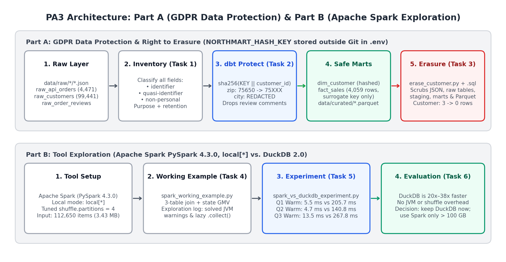

# NorthMart Data Platform — PA3: Data Protection (GDPR) & Tool Exploration (Apache Spark)

**Course:** Data Engineering (2026/2027) — Practical Assessment 3 (PA3)  
**Group 4 Members:**
- **Lucas Alves Rubira** (`a67707`)
- **Dorota Dudkowiak** (`m324637`)
- **Aye Khine Lwin** (`a70733`)

---

## 1. Architecture & Repository Overview



```text
AP3/
├── README.md                                  # Reproduction guide & written answers (Tasks 1–6)
├── requirements.txt                           # Python dependencies (DuckDB, dbt, Airflow, PySpark)
├── .gitignore                                 # Excludes data/source/, data/raw/, *.duckdb, .env
├── .env.example                               # Template for external NORTHMART_HASH_KEY
├── mock_api.py                                # NorthMart mock orders REST API
├── architecture/
│   ├── gdpr_pipeline_ap3.mmd                  # PA3 GDPR protection & erasure Mermaid diagram
│   ├── gdpr_pipeline_ap3.png                  # PA3 architecture diagram (PNG)
│   ├── pipeline_ap2.mmd / .png                # PA2 ELT orchestration diagram
│   └── star_schema.mmd / .png                 # PA1 Kimball star schema diagram
├── sql/
│   ├── build_model.sql                        # Raw tables & baseline dimensions in DuckDB
│   ├── init_ap2_db.sql                        # Raw API landing table DDL
│   ├── erase_customer.sql                     # Task 3: Atomic GDPR Art. 17 customer erasure SQL
│   ├── profiling.sql                          # PA1 data profiling queries
│   └── benchmark.sql                          # PA1 storage benchmark queries
├── src/
│   ├── init_db.py                             # Database initializer & 14-day backfill helper
│   ├── extract_orders.py                      # Paginated API extractor with HTTP 503 retry
│   ├── load_raw.py                            # Atomic transactional raw batch loader
│   ├── erase_customer.py                      # Task 3: End-to-end GDPR erasure across all layers
│   └── generate_diagram.py                    # Diagram generator
├── dbt/
│   ├── dbt_project.yml & profiles.yml
│   ├── models/
│   │   ├── staging/
│   │   │   ├── sources.yml
│   │   │   ├── stg_customers.sql              # Task 2: Keyed SHA-256 hash + location generalization
│   │   │   ├── stg_orders.sql                 # Task 2: Keyed SHA-256 hash on order customer_id
│   │   │   ├── stg_reviews.sql                # Task 2: Excludes free-text review comments
│   │   │   └── schema.yml                     # 26 generic data quality & privacy tests
│   │   └── marts/
│   │       ├── dim_customer.sql               # Task 2: Protected customer dimension
│   │       └── fact_sales.sql                 # Incremental delete+insert fact table
│   ├── macros/test_accepted_range.sql
│   └── tests/assert_valid_marketplace_order_economics.sql
├── airflow/dags/
│   └── northmart_elt_dag.py                   # Daily ELT DAG with GDPR dbt transformations
├── exploration/                               # Part B: Apache Spark (PySpark 4.3.0, local mode)
│   ├── spark_working_example.py               # Task 4: Minimal working example on NorthMart data
│   ├── spark_vs_duckdb_experiment.py          # Task 5: Controlled benchmark (Spark vs. DuckDB)
│   └── exploration_log.md                     # Task 4: Log of what we tried, failed, and solved
├── tests/
│   ├── run_tests.py                           # Automated 8-check integrity & GDPR privacy suite
│   └── test_referential_integrity.sql
└── evidence/
    ├── personal_data_inventory.md / .csv      # Task 1: Complete GDPR field classification
    ├── protected_dim_customer_sample.txt      # Task 2: Sample output of protected dim_customer
    ├── erasure_before_after.txt               # Task 3: Before vs. after counts across all 9 layers
    ├── spark_working_example_output.txt       # Task 4: PySpark working example output
    ├── spark_vs_duckdb_experiment.txt / .csv  # Task 5: Spark vs. DuckDB benchmark output
    └── referential_checks_output.txt          # Automated verification suite output
```

---

## 2. How to Reproduce All Results

### Step 1: Environment & Secret Key Setup
Place the Kaggle Olist CSV files, `northmart_seller_profiles.json`, and `northmart_api_feed.parquet` in `AP3/data/source/`. Create your local `.env` file (kept outside Git via `.gitignore`):

```bash
cd AP3
source ../.venv/bin/activate
export NORTHMART_HASH_KEY="northmart_gdpr_secret_key_2026"
```

### Step 2: Build Protected Pipeline & Inspect `dim_customer` (Part A — Tasks 1 & 2)
```bash
python src/init_db.py --rebuild --backfill
```
Inspect the pseudonymized `dim_customer` dimension and `stg_reviews` (without free-text comments):
```bash
python -c "
import duckdb
con = duckdb.connect('northmart.duckdb', read_only=True)
print(con.execute('SELECT * FROM dim_customer LIMIT 5'). fetchdf().to_string())
print('stg_reviews columns:', [c[0] for c in con.execute('DESCRIBE stg_reviews').fetchall()])
"
```

### Step 3: Run GDPR Art. 17 Customer Erasure & Verify Before/After Counts (Part A — Task 3)
```bash
python src/erase_customer.py --customer-id d1806517abdeab70d77e1ff58ec5f1b8
python tests/run_tests.py
```

### Step 4: Run Apache Spark Working Example & Spark vs. DuckDB Experiment (Part B — Tasks 4 & 5)
```bash
python exploration/spark_working_example.py
python exploration/spark_vs_duckdb_experiment.py
```

---

## 3. Part A — Data Protection (Tasks 1, 2, and 3)

### Task 1 — Personal Data Inventory (GDPR Classification)

Full tables are also stored in [evidence/personal_data_inventory.md](evidence/personal_data_inventory.md) and [evidence/personal_data_inventory.csv](evidence/personal_data_inventory.csv).

#### 1.1 Raw Customers (`raw_customers` / `olist_customers_dataset.csv`)
| Field | Classification | Action in Marts (`dim_customer`) | Purpose | Retention Period |
|---|---|---|---|---|
| `customer_id` | `identifier` | **Keyed SHA-256 Hash** (`sha256(KEY \|\| customer_id)`) | Join orders in `stg_orders` to `dim_customer` without raw ID | 5 years (statutory tax/accounting) or immediate upon GDPR Art. 17 erasure |
| `customer_unique_id` | `identifier` | **Keyed SHA-256 Hash** (`sha256(KEY \|\| customer_unique_id)`) | Repeat-purchase and customer cohort retention analytics | 5 years or immediate upon GDPR Art. 17 erasure |
| `customer_zip_code_prefix` | `quasi-identifier` | **Generalize** (`'75650'` $\rightarrow$ `'75XXX'`, 2-digit postal region) | Macro-regional freight zone analytics | 5 years (in generalized form); erased upon GDPR request |
| `customer_city` | `quasi-identifier` | **Drop / Redact** (`'REDACTED'`) | Removed (small cities enable re-identification when combined with timestamps) | 30 days in raw landing only; 0 days in marts |
| `customer_state` | `quasi-identifier` | **Keep Generalized** (2-letter state code, e.g., `'SP'`, `'GO'`) | State-level revenue and regional sales reporting | 5 years; erased upon GDPR request |

#### 1.2 Raw Orders & API Feed (`raw_orders`, `raw_order_items`, `raw_api_orders`)
| Field | Classification | Action in Marts (`stg_orders` / `fact_sales`) | Purpose | Retention Period |
|---|---|---|---|---|
| `order_id` | `quasi-identifier` | **Keep** (dissociated from raw `customer_id`) | Composite fact grain `(order_id, order_item_id)` & idempotent `delete+insert` | 5 years (tax audit trail); erased if linked customer requests GDPR erasure |
| `order_item_id` | `non-personal` | **Keep** | Line item sequence number (`1, 2, 3...`) within an order | 5 years |
| `customer_id` | `identifier` | **Keyed SHA-256 Hash** in `stg_orders` $\rightarrow$ surrogate `customer_key` in `fact_sales` | Resolve foreign key `customer_key` in `fact_sales` | 30 days in raw API table; hashed in staging; erased upon GDPR request |
| `product_id` | `non-personal` | **Keep** $\rightarrow$ surrogate `product_key` in `fact_sales` | Product and category revenue analysis | Indefinite (non-personal catalog data) |
| `seller_id` | `identifier` | **Keep** $\rightarrow$ surrogate `seller_key` in `fact_sales` | Merchant revenue attribution & SLA tracking | 5 years after seller contract ends |
| `order_status` | `non-personal` | **Keep** (normalized lowercase) | Order lifecycle & cancellation filtering | 5 years |
| `order_purchase_timestamp` | `quasi-identifier` | **Generalize in Marts** to daily `date_key` (`YYYYMMDD`) & `year_month` | Daily and monthly sales trend aggregation | 30 days timestamp in staging; 5 years as daily `date_key` in marts |
| `order_approved_at`, `order_delivered_carrier_date`, `order_delivered_customer_date`, `order_estimated_delivery_date` | `quasi-identifier` | **Drop** (not loaded into `fact_sales`) | Not required for sales revenue star schema | 30 days in raw layer only |
| `price`, `freight_value` | `non-personal` | **Keep** (`DOUBLE`, rounded 2 decimals) | Gross merchandise revenue and shipping cost measures | 5 years |

#### 1.3 Raw Seller Profiles (`raw_sellers_json` / `northmart_seller_profiles.json` & `raw_sellers`)
| Field | Classification | Action in Marts (`dim_seller`) | Purpose | Retention Period |
|---|---|---|---|---|
| `seller_id` | `identifier` | **Keep** (B2B merchant identifier $\rightarrow$ `seller_key`) | Join sales items to seller dimension | 5 years after seller contract ends |
| `contact.email` | `identifier` | **Drop** (never loaded into `dim_seller`) | Direct contact PII — zero analytical need in BI marts | 0 days in analytical layer |
| `contact.phone` | `identifier` | **Drop** (never loaded into `dim_seller`) | Direct contact PII — zero analytical need in BI marts | 0 days in analytical layer |
| `seller_zip_code_prefix`, `seller_city`, `seller_state` | `quasi-identifier` | **Keep** (commercial warehouse location) | Freight origin and merchant supply distribution | 5 years |
| `profile.tier`, `shipping.handling_days` | `non-personal` | **Keep** | Seller tier revenue and dispatch SLA analysis | 5 years |
| `profile.joined_on` | `quasi-identifier` | **Keep** (`DATE`) | Seller tenure cohort analysis | 5 years |
| `shipping.carriers`, `updated_at` | `non-personal` | **Drop from marts** (`updated_at` used only for deduplication) | Deduplicate seller JSON snapshots | 30 days in raw layer |

#### 1.4 Raw Order Reviews (`raw_order_reviews` / `olist_order_reviews_dataset.csv`)
| Field | Classification | Action in Marts (`stg_reviews`) | Purpose | Retention Period |
|---|---|---|---|---|
| `review_id`, `review_score`, `review_answer_timestamp` | `non-personal` | **Keep** in `stg_reviews` | Customer satisfaction KPI and support SLA tracking | 2–5 years |
| `order_id`, `review_creation_date` | `quasi-identifier` | **Keep** in `stg_reviews` | Link review rating to order date | 2 years (erased upon GDPR request) |
| `review_comment_title`, `review_comment_message` | `quasi-identifier` (Free Text) | **DROP — Never loaded into staging or marts** | Excluded: free text often contains names, phone numbers, addresses, or CPFs | **0 days in analytical layer** |

---

### Task 2 — Pipeline Protection & Written Explanation: Why the Result is Pseudonymized (and Not Anonymized)

#### How Protection is Implemented in `dbt`:
1. **Keyed Hash from Environment Variable (`stg_customers.sql`, `dim_customer.sql`, `stg_orders.sql`):**
   We compute `sha256('{{ env_var("NORTHMART_HASH_KEY") }}' || TRIM(customer_id))` and `sha256('{{ env_var("NORTHMART_HASH_KEY") }}' || TRIM(customer_unique_id))`. The secret key `NORTHMART_HASH_KEY` is read strictly from the environment (`.env` is gitignored). In `stg_orders.sql`, we guard with `CASE WHEN NULLIF(TRIM(customer_id), '') IS NOT NULL THEN sha256(...) ELSE NULL END` so missing customer IDs remain `NULL` and are still caught by the `not_null` quality gate.
2. **Customer Location Generalization (`stg_customers.sql` $\rightarrow$ `dim_customer.sql`):**
   The 5-digit `customer_zip_code_prefix` (e.g., `'75650'`) is generalized to its 2-digit postal macro-region (`'75XXX'`), `customer_city` is masked to `'REDACTED'`, and only the 2-letter `state` (`'GO'`, `'SP'`, etc.) is retained for regional reporting.
3. **Free-Text Exclusion (`stg_reviews.sql`):**
   `review_comment_title` and `review_comment_message` are completely excluded from `stg_reviews` and the marts because unstructured text can contain arbitrary self-disclosed PII (names, phone numbers, home addresses) that hashing cannot sanitize.

#### Written Answer — Why is the result *pseudonymized* and NOT truly *anonymized* under GDPR?
Under **GDPR Article 4(5)** and **Recital 26**, our protected marts are **pseudonymized**, not truly **anonymized**, for two concrete reasons:
1. **Reversibility via the Secret Key and Raw Data (Keyed Hash Linkability):** Because `sha256(NORTHMART_HASH_KEY || customer_id)` is a deterministic keyed hash and NorthMart retains `NORTHMART_HASH_KEY` (to allow daily `stg_orders` joins to `dim_customer`), anyone with access to the secret key can re-compute the hash for a known `customer_id` and link the mart records back to the individual.
2. **Event-Level Granularity & Quasi-Identifier Singling Out:** `fact_sales` still stores individual order-item rows with exact `order_id`, `date_key`, `price`, `freight_value`, `product_key`, and generalized `state`/`zip_code_prefix`. Someone who knows a customer bought 3 items of product $P$ for $\$53.90$ in state `GO` on `2018-05-01` can still single out that person's records (*linkability / inference*). True **anonymization** requires irreversible aggregation (e.g., monthly revenue by state) where no row corresponds to an individual person and re-identification is impossible for anyone. Because pseudonymized data remains **personal data under GDPR**, we must still execute **Task 3 (Right to Erasure)** across the marts!

---

### Task 3 — GDPR Right to Erasure (`sql/erase_customer.sql` & `src/erase_customer.py`)

When customer `d1806517abdeab70d77e1ff58ec5f1b8` (who placed order `a0b393aaf1085966f34beb2d95817462` with 3 items on `2018-05-01`) requests erasure under **GDPR Article 17**:
1. `src/erase_customer.py` resolves any sibling `customer_id`s sharing the same `customer_unique_id` (`e8d7e19524297d8d550594ba07bb139b`), computes their keyed SHA-256 hash (`92455103b9a4ef10ad02498d0f7d72dfd69d47c6e1a7fb8dc2247636d095403c`), and looks up surrogate key `customer_key = 57079` in `dim_customer`.
2. It scrubs the customer's 3 items from `data/raw/2018-05-01/page_*.json`.
3. It executes `sql/erase_customer.sql` inside a single atomic transaction (`BEGIN TRANSACTION ... COMMIT`), deleting the customer from `fact_sales`, `dim_customer`, `stg_orders`, `raw_api_orders`, `raw_orders`, and `raw_customers`, and re-exporting `data/curated/fact_sales.parquet` and `data/curated/fact_sales_partitioned/`.

#### Measured Before vs. After Counts ([evidence/erasure_before_after.txt](evidence/erasure_before_after.txt)):

| Storage Layer / Table | Target Customer Rows (Before $\rightarrow$ After) | Total Layer Rows (Before $\rightarrow$ After) |
|---|---|---|
| 1. `data/raw/*.json` (Landed API JSON files) | `3 -> 0` | `4,471 -> 4,468 (-3)` |
| 2. `raw_api_orders` (DuckDB Raw API table) | `3 -> 0` | `4,471 -> 4,468 (-3)` |
| 3. `raw_customers` (DuckDB Raw Customers) | `1 -> 0` | `99,441 -> 99,440 (-1)` |
| 4. `raw_orders` (DuckDB Raw Orders) | `1 -> 0` | `99,441 -> 99,440 (-1)` |
| 5. `stg_orders` (dbt Staging table, `2018-05-01`) | `3 -> 0` | `277 -> 274 (-3)` |
| 6. `dim_customer` (dbt Protected Mart Dimension) | `1 -> 0` | `99,441 -> 99,440 (-1)` |
| 7. `fact_sales` (dbt Incremental Mart Fact) | `3 -> 0` | `4,059 -> 4,056 (-3)` |
| 8. `data/curated/fact_sales.parquet` | `3 -> 0` | `4,059 -> 4,056 (-3)` |
| 9. `data/curated/fact_sales_partitioned/` | `3 -> 0` | `4,059 -> 4,056 (-3)` |

---

## 4. Part B — Tool Exploration: Apache Spark (`PySpark 4.3.0`, Local Mode)

### Task 4 — Minimal Working Example & Exploration Log
- **Working Example Script:** [exploration/spark_working_example.py](exploration/spark_working_example.py) (output in [evidence/spark_working_example_output.txt](evidence/spark_working_example_output.txt)) loads NorthMart's `orders`, `order_items`, and `customers` into PySpark DataFrames, executes a 3-table join and state-level GMV aggregation, and outputs the top 10 states.
- **Exploration Log:** Detailed in [exploration/exploration_log.md](exploration/exploration_log.md), covering three concrete challenges we encountered and solved:
  1. **JVM Loopback & Port 4040 Warnings:** Solved by setting `.config("spark.driver.host", "127.0.0.1")`, `.config("spark.ui.enabled", "false")`, and `spark.sparkContext.setLogLevel("ERROR")`.
  2. **The Lazy Evaluation Benchmarking Trap:** Calling `spark.sql(query)` alone returned in `~1.5 ms` because Spark transformations are lazy; we added `.collect()` inside the timer to force physical DAG execution.
  3. **Shuffle Overhead from Default `spark.sql.shuffle.partitions = 200`:** Splitting a `3.43 MB` dataset across 200 shuffle tasks created heavy scheduling overhead; tuning `spark.sql.shuffle.partitions` to `4` (local CPU cores) reduced warm query time by up to 31%.

---

### Task 5 — Controlled Experiment: Is the Same Aggregation Faster in Spark or in DuckDB at This Data Size, and Why?

Script: [exploration/spark_vs_duckdb_experiment.py](exploration/spark_vs_duckdb_experiment.py) | Full output: [evidence/spark_vs_duckdb_experiment.txt](evidence/spark_vs_duckdb_experiment.txt) & [evidence/spark_vs_duckdb_results.csv](evidence/spark_vs_duckdb_results.csv).

We benchmarked the 3 canonical NorthMart analytical queries on the full `112,650`-row `fact_sales` Parquet file (`3.43 MB` ZSTD) + `dim_product` (`32,951` rows) across 5 warm runs after 1 cold run:

| Metric / Query | DuckDB (`2.0.0`) | PySpark (`p=200` default) | PySpark (`p=4` tuned) | DuckDB Speedup vs. Spark (`p=4`) |
|---|---|---|---|---|
| **Engine Session Startup Time** | **18.37 ms** | 9,275.85 ms | 8,901.89 ms | **484.6x faster startup** |
| **Q1: Monthly Revenue (`GROUP BY year_month`)** | **5.49 ms** | 299.64 ms | 205.73 ms | **37.5x faster** |
| **Q2: Single Month (`WHERE year_month='2018-05'`)** | **4.65 ms** | 160.00 ms | 140.77 ms | **30.2x faster** |
| **Q3: Top 5 Categories (`JOIN dim_product`)** | **13.52 ms** | 304.06 ms | 267.80 ms | **19.8x faster** |

**Answer to Task 5:** At NorthMart's current scale (`112,650` rows, `3.43 MB` Parquet / `120 MB` raw CSV), **DuckDB is 19.8x to 37.5x faster than PySpark on warm queries and ~485x faster to initialize**. This happens because DuckDB runs in-process in C++ using vectorized morsel-driven execution directly on local CPU cache with zero network or IPC serialization, whereas Spark incurs fixed distributed-computing costs: JVM startup (`~9.3 s`), Catalyst logical-to-physical DAG compilation, task scheduling, and shuffle stage serialization across partitions.

---

### Task 6 — Evaluation of Apache Spark for NorthMart (Max. 300 Words)

*(Word count: 238 words)*

**What Apache Spark is for:**  
Apache Spark is a distributed, fault-tolerant cluster computing engine designed for large-scale data processing, multi-terabyte ETL, distributed SQL, and streaming across horizontal clusters of commodity machines when datasets exceed the memory or disk bandwidth of a single server.

**When it should not be used:**  
Spark should not be used for small-to-medium analytical workloads (megabytes to tens of gigabytes) that fit comfortably in the RAM of a single node, or for low-latency interactive BI queries. As our Task 5 measurements prove on NorthMart's 112,650-row dataset (`3.43 MB` Parquet), PySpark takes `9.28 seconds` just to start the JVM session and `140–268 ms` per warm query—making it **20x to 38x slower** than DuckDB (`4.65–13.52 ms`), even after tuning `spark.sql.shuffle.partitions` from `200` down to `4`.

**What it costs in complexity:**  
Adopting Spark introduces substantial operational and engineering overhead: managing a Java Virtual Machine (JVM) runtime alongside Python, configuring shuffle partitions and memory allocation, debugging distributed DAG stages and lazy evaluation, and maintaining cluster infrastructure (such as Kubernetes, YARN, or Databricks) instead of a zero-dependency embedded library.

**Whether NorthMart should adopt it now:**  
**No, NorthMart should not adopt Apache Spark now.** NorthMart's entire historical dataset (`120 MB` raw CSV, `3.43 MB` compressed Parquet) and daily increments (`~350` rows/day) easily fit in a few megabytes of RAM. Keeping **DuckDB + dbt + Parquet** delivers sub-15 ms query latency with zero cluster cost, while storing data in open Parquet files ensures NorthMart can seamlessly add Spark in the future only if data volume grows beyond ~100 GB.
